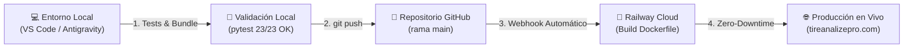

# 🚀 Guía de Despliegue a Producción — TireAnalyze Pro
### Flujo de Integración y Entrega Continua (CI/CD) con GitHub y Railway

Este documento detalla el paso a paso estándar, comandos de consola, buenas prácticas y solución de problemas para publicar cambios de forma segura en **[www.tireanalizepro.com](https://www.tireanalizepro.com)**.

---

## 🏗️ 1. Arquitectura del Despliegue



| Componente | Servicio / Herramienta | Detalle Técnico |
| :--- | :--- | :--- |
| **Control de Versiones** | GitHub | Repositorio: `Cristian1829/tirecheck-pro` · Rama: `main` |
| **Plataforma Cloud** | Railway | Proyecto vinculado a GitHub con despliegue automático |
| **Motor de Ejecución** | Dockerfile | Base `python:3.12-slim` configurado en `railway.json` |
| **Servidor Web** | FastAPI + Uvicorn | Ejecutado mediante `python server.py` en puerto dinámico `$PORT` |
| **Persistencia** | Volumen Railway | Montado en `/app/data` para SQLite (`inspecciones.db`) |
| **Dominio y SSL** | Cloudflare / Railway | Certificados HTTPS automáticos gestionados por Railway |

---

## 📋 2. Checklist Obligatorio Antes de Desplegar

Antes de enviar cualquier cambio a la rama `main`, ejecuta siempre estas 3 comprobaciones en tu terminal local:

### Paso A: Validar la suite de pruebas automatizadas
Garantiza que ningún cambio rompa autenticación, APIs ni plantillas web:
```powershell
python -m pytest tests/test_api_web.py
```
> **Criterio de éxito:** Los **23 tests deben salir en verde (100% passed)**. Si alguno falla, corrígelo antes de continuar.

### Paso B: Regenerar el bundle de código consolidado
Mantiene sincronizada la documentación maestra del proyecto:
```powershell
python scripts/generar_bundle_codigo_md.py
```
> **Criterio de éxito:** Salida confirmando `¡ÉXITO TOTAL!` y actualización de `CODIGO_COMPLETO_PROYECTO.md`.

### Paso C: Revisar los archivos modificados
Verifica qué archivos fueron alterados y asegúrate de no incluir archivos temporales o credenciales:
```powershell
git status -s
```

---

## ⚡ 3. Paso a Paso para Desplegar (Paso a Paso)

Abre la terminal en la carpeta del proyecto (`c:\Users\crist\OneDrive\Documentos\Tyre\TireCheck_Pro_Proyecto`) y ejecuta:

### 1️⃣ Preparar los archivos para el commit
Puedes agregar archivos específicos o todo el proyecto:
```powershell
# Opción recomendada: agregar solo los archivos que modificaste
git add templates/servicios.html server.py tests/test_api_web.py CODIGO_COMPLETO_PROYECTO.md

# O si modificaste múltiples archivos del proyecto:
git add .
```

### 2️⃣ Crear el Commit con un mensaje descriptivo
Usa la convención de commits semánticos para mantener un historial ordenado:
```powershell
# Para nuevas funcionalidades:
git commit -m "feat(servicios): actualizar landing a version v3 con diseño industrial"

# Para corrección de errores:
git commit -m "fix(inspecciones): corregir validacion de limite de profundidad en eje trasero"

# Para mejoras visuales o de texto:
git commit -m "refactor(ui): simplificar lenguaje comercial y destacar inspeccion en patio"
```

### 3️⃣ Enviar los cambios a GitHub (Disparador de Producción)
```powershell
git push origin main
```
> ⏱️ **¿Qué ocurre al ejecutar `git push`?**
> Inmediatamente GitHub recibe el commit y notifica a Railway mediante un webhook. Railway inicia automáticamente la fase de compilación y despliegue sin que tengas que presionar ningún botón adicional.

---

## 🔍 4. Monitoreo y Verificación del Despliegue

El ciclo completo de despliegue toma aproximadamente **40 a 90 segundos**.

### Opción A: Monitoreo desde el Dashboard de Railway (Recomendado)
1. Ingresa a **[railway.app](https://railway.app)** e inicia sesión.
2. Abre tu proyecto (`tirecheck-pro` / `TireAnalyze Pro`).
3. Haz clic en la pestaña **Deployments**:
   - Verás el commit que acabas de enviar en estado `Building` 🟡.
   - Una vez finalizada la construcción, pasará a `Deploying` 🔵.
   - Cuando esté listo, mostrará el estado `Active` 🟢 con el check verde.
4. En la pestaña **Deploy Logs** puedes ver el proceso de instalación de Docker y `requirements.txt`.
5. En la pestaña **Runtime Logs** puedes ver el arranque de FastAPI y las peticiones en vivo.

### Opción B: Verificación rápida desde la Terminal
Ejecuta una petición con `curl` para confirmar que el servidor responde con el nuevo contenido:
```powershell
# Probar cabeceras y estado 200 OK
curl.exe -s --max-time 10 "https://www.tireanalizepro.com/servicios" | Select-String -Pattern "TireAnalyze Pro"

# O probar que el alias /landing esté activo
curl.exe -s --max-time 10 "https://www.tireanalizepro.com/landing" | Select-String -Pattern "TireAnalyze Pro"
```

### Opción C: Verificación en el Navegador
Abre en modo incógnito (para evitar caché local):
- **Landing de Servicios:** [https://www.tireanalizepro.com/servicios](https://www.tireanalizepro.com/servicios)
- **Plataforma Web:** [https://www.tireanalizepro.com](https://www.tireanalizepro.com)

---

## 🛡️ 5. Separación Estricta de Datos: QA Local vs. Producción

> [!IMPORTANT]
> **Regla de Oro:** La información de pruebas, inspecciones de QA y clientes de prueba creados en tu entorno local **NUNCA se deben mezclar ni subir a Producción**. Son entornos 100% aislados.

### ¿Cómo se garantiza esta separación?
1. **Exclusión en Git (`.gitignore`):**
   - Todos los archivos `*.db`, `data/*.db`, `seed_inspecciones.db` y archivos temporales SQLite están ignorados en Git y desvinculados del índice remoto.
   - Aunque hagas `git add .`, Git **jamás incluirá tus inspecciones locales**. Tu archivo `data/inspecciones.db` local se queda intacto en tu máquina para tu trabajo diario de QA.

2. **Exclusión en el Contenedor Docker (`.dockerignore`):**
   - El archivo `.dockerignore` bloquea explícitamente `data/` y `*.db`.
   - Cuando Railway construye la imagen del software, **no empaqueta ninguna base de datos de tu computadora**.

3. **Persistencia Autónoma en Railway:**
   - La base de datos de producción vive **única y exclusivamente dentro del volumen persistente de Railway** montado en `/app/data`.
   - Al desplegar nuevo código (`git push origin main`), Railway solo actualiza los archivos del programa (rutas, plantillas, APIs). El archivo de base de datos del cliente en producción **permanece inalterado y protegido**.

| Entorno | Ubicación de la Base | ¿Sube a GitHub? | ¿Se afecta con despliegues? |
| :--- | :--- | :--- | :--- |
| **QA / Local** | `TireCheck_Pro_Proyecto/data/inspecciones.db` | ❌ No (Ignorado) | ❌ No (Vive solo en tu máquina) |
| **Producción** | Volumen persistente Railway en `/app/data` | ❌ No (Vive en la nube) | 🛡️ Protegido contra sobreescritura |

---

## 🔧 6. Solución de Problemas Comunes (Troubleshooting)

### 🔴 Error 1: Fallo en el Build (`pip install error` o dependencias)
- **Causa:** Agregaste un nuevo paquete en Python (ej. `reportlab` o `pillow`) en tu código local pero no lo agregaste a `requirements.txt`.
- **Solución:**
  1. Agrega la librería a `requirements.txt`.
  2. Haz commit y push de `requirements.txt`.

### 🔴 Error 2: El contenedor se reinicia constantemente (`Application crashed`)
- **Causa:** Error de sintaxis en `server.py` o falta de una variable de entorno.
- **Solución:**
  1. Ve a Railway -> Pestaña **Runtime Logs**.
  2. Lee la última línea del Traceback en rojo.
  3. Ejecuta `python server.py` localmente para reproducir y resolver el error antes de subirlo.

### 🔴 Error 3: En el navegador no se ven los cambios más recientes
- **Causa:** Caché agresiva del navegador o de Cloudflare.
- **Solución:**
  1. Presiona `Ctrl + F5` en el navegador para recarga forzada sin caché.
  2. Abre la URL en una ventana de incógnito.
  3. Comprueba en Railway que el commit desplegado (`Active`) coincida con el hash de tu último `git log -1`.

### 🔴 Error 4: Necesitas volver a una versión anterior urgente (Rollback)
Si un cambio introdujo un error crítico en producción y necesitas volver atrás inmediatamente:
1. En el panel de **Railway**, ve a la lista de **Deployments**.
2. Busca el despliegue anterior que estaba funcionando correctamente.
3. Haz clic en los tres puntos `...` del despliegue anterior y selecciona **Rollback**.
4. Railway activará la versión anterior en menos de 10 segundos mientras corriges el problema en tu máquina local.

---

## 📌 7. Resumen de Comando Rápido (Cheat Sheet)

Guarda este flujo para despliegues diarios:

```powershell
# 1. Probar
python -m pytest tests/test_api_web.py

# 2. Documentar
python scripts/generar_bundle_codigo_md.py

# 3. Subir
git add .
git commit -m "feat(modulo): descripcion de la mejora"
git push origin main

# 4. Verificar en vivo
curl.exe -s --max-time 10 "https://www.tireanalizepro.com/servicios" | Select-String "TireAnalyze Pro"
```

---
*Documento generado para el equipo técnico y de operaciones de **TireAnalyze Pro** — © 2026 Todos los derechos reservados.*
