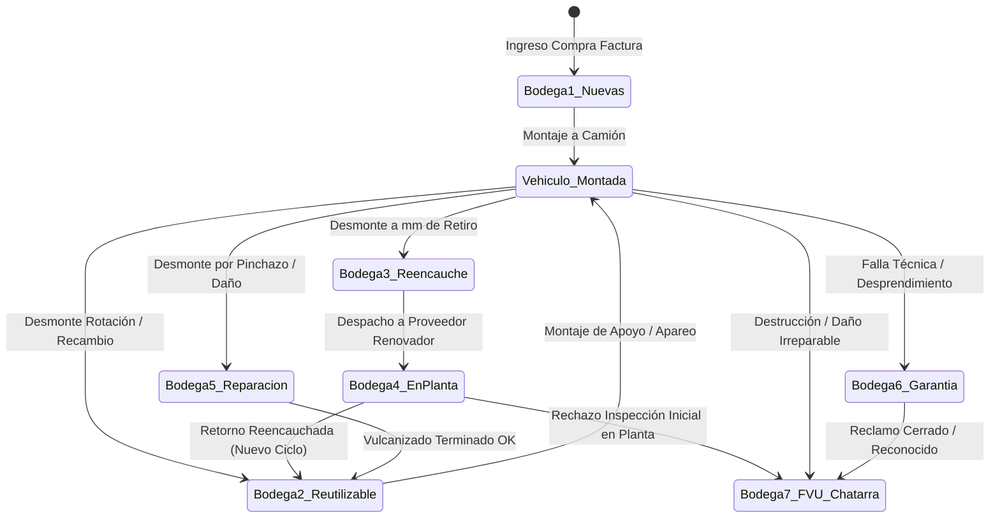

# Especificación Técnica de Bodegas y Hoja de Vida de Neumáticos (Para Implementación en Software Externo)

Este documento define la arquitectura integral para el control de inventarios segregados, transiciones de estado y la trazabilidad de ciclo de vida completo (Hoja de Vida) de neumáticos comerciales en flotas de transporte.

---

## 1. Topología de las 7 Bodegas Especializadas

En la gestión profesional de flotas de carga y pasajeros, las llantas no se manejan en un inventario genérico, sino en **7 sub-bodegas virtuales/físicas** con propósitos específicos:



### Detalle Operativo por Bodega:
1. **Bodega 1 (Nuevas - Stock Compras):**
   - Llantas 0 km con banda de rodamiento original de fábrica (14 mm a 22 mm según diseño).
   - Registra costo de adquisición unitario, número de factura y proveedor.
2. **Bodega 2 (Reutilizables / Stock de Patio):**
   - Llantas usadas con profundidad remanente útil (por encima del límite de retiro).
   - Desmontadas por balance de ejes, nivelación de pachas, desmonte temporal de repuestos o devueltas de planta tras reencauche.
   - Listas para aparear con otras ruedas o rotar a vehículos secundarios.
3. **Bodega 3 (Reencauche / En Alistamiento de Despacho):**
   - Llantas que alcanzaron la profundidad óptima de retiro (ej. 3.0 mm a 4.5 mm) cuya carcasa está estructuralmente sana para recibir una nueva banda.
   - Agrupa lotes para emisión de guía de remisión a la renovadora.
4. **Bodega 4 (En Planta Externa de Renovado / En Tránsito):**
   - Neumáticos físicamente fuera de las instalaciones del cliente, bajo custodia del proveedor reencauchador.
   - Rastrea número de orden de servicio externa, fecha de entrega esperada y costos cotizados de banda.
5. **Bodega 5 (Reparaciones / Sección / Parche):**
   - Neumáticos con clavos, pérdidas de presión o cortes en flanco reparables.
   - Al salir reparadas con prueba hidrostática, ingresan a Bodega 2.
6. **Bodega 6 (Garantías en Trámite):**
   - Neumáticos con fallas prematuras de fabricación (separación de lonas, rotura de ceja, porosidad).
   - Controla el porcentaje de reconocimiento económico (nota de crédito del proveedor).
7. **Bodega 7 (Fin de Vida Útil - FVU / Chatarra / Desecho):**
   - Cementerio definitivo de llantas destruidas o que agotaron todos sus ciclos de reencauche (R3/R4).
   - Audita mm desperdiciados, dinero perdido y causa raíz del desecho.

---

## 2. Modelo Relacional de Base de Datos (DDL SQL)

Diseñado para soportar PostgreSQL, MySQL o SQLite:

```sql
-- TABLA MAESTRA DE LA CARCASA / LLANTA
CREATE TABLE llantas_maestro (
    id SERIAL PRIMARY KEY,
    numero_interno VARCHAR(50) UNIQUE NOT NULL,      -- Código de fuego o número económico
    numero_serie_dot VARCHAR(50),                     -- DOT grabado por fabricante
    marca_origen VARCHAR(50) NOT NULL,
    diseno_origen VARCHAR(50) NOT NULL,
    dimension VARCHAR(30) NOT NULL,                  -- ej. '295/80R22.5'
    tipo_construccion VARCHAR(20) DEFAULT 'Radial',
    indice_carga_velocidad VARCHAR(20),
    precio_compra_inicial NUMERIC(12, 2) DEFAULT 0.0,
    prof_inicial_nueva NUMERIC(4, 1) DEFAULT 16.0,
    
    -- Estado Actual en Flota
    estado_actual VARCHAR(30) NOT NULL DEFAULT 'Bodega_1_Nuevas',
    -- 'Bodega_1_Nuevas', 'Bodega_2_Reutilizable', 'Bodega_3_Reencauche', 
    -- 'Bodega_4_EnPlanta', 'Bodega_5_Reparacion', 'Bodega_6_Garantia', 
    -- 'Bodega_7_FVU', 'Montada'
    
    placa_actual VARCHAR(10) DEFAULT NULL,
    posicion_actual INTEGER DEFAULT 0,
    tipo_eje_actual VARCHAR(20) DEFAULT '',          -- 'direccional', 'traccion', 'libre'
    prof_actual_min NUMERIC(4, 1) DEFAULT 0.0,
    
    -- Métricas Consolidadas de Vida
    ciclo_actual INTEGER DEFAULT 1,                  -- 1 = Original, 2 = R1, 3 = R2, etc.
    km_acumulados_total NUMERIC(12, 1) DEFAULT 0.0,
    costo_reencauches_total NUMERIC(12, 2) DEFAULT 0.0,
    costo_reparaciones_total NUMERIC(12, 2) DEFAULT 0.0,
    cpk_acumulado_global NUMERIC(8, 4) DEFAULT 0.0,
    
    -- Propiedad y Ubicación
    cliente_propietario VARCHAR(100) NOT NULL,
    subcliente_sede VARCHAR(100) DEFAULT 'Principal',
    fecha_alta DATE DEFAULT CURRENT_DATE,
    fecha_baja DATE DEFAULT NULL,
    motivo_baja VARCHAR(100) DEFAULT NULL,
    mm_desperdiciados_fvu NUMERIC(4, 1) DEFAULT 0.0,
    dinero_perdido_fvu NUMERIC(12, 2) DEFAULT 0.0
);

-- TABLA DE HISTÓRICO DE CICLOS DE VIDA (ORIGINAL, R1, R2, R3...)
CREATE TABLE llantas_ciclos (
    id SERIAL PRIMARY KEY,
    numero_interno VARCHAR(50) NOT NULL REFERENCES llantas_maestro(numero_interno) ON DELETE CASCADE,
    numero_ciclo INTEGER NOT NULL,                   -- 1, 2, 3...
    tipo_ciclo VARCHAR(20) NOT NULL,                 -- 'Original', 'Reencauche 1', 'Reencauche 2'
    proveedor_banda VARCHAR(100),                    -- ej. 'Bandag', 'Michelin Recamic', 'Marangoni'
    diseno_banda VARCHAR(50),
    prof_inicial_ciclo NUMERIC(4, 1) NOT NULL,
    prof_final_ciclo NUMERIC(4, 1) DEFAULT NULL,
    km_inicial_ciclo NUMERIC(12, 1) DEFAULT 0.0,
    km_final_ciclo NUMERIC(12, 1) DEFAULT NULL,
    km_recorridos_ciclo NUMERIC(12, 1) DEFAULT 0.0,
    costo_ciclo NUMERIC(12, 2) DEFAULT 0.0,
    cpk_ciclo NUMERIC(8, 4) DEFAULT 0.0,
    fecha_inicio_ciclo DATE DEFAULT CURRENT_DATE,
    fecha_fin_ciclo DATE DEFAULT NULL,
    estado_ciclo VARCHAR(20) DEFAULT 'En_Servicio'   -- 'En_Servicio', 'Cerrado_Por_Retiro', 'Desechado'
);

-- TABLA DE LOG DE MOVIMIENTOS Y TRANSACCIONES DE TALLER
CREATE TABLE llantas_movimientos (
    id SERIAL PRIMARY KEY,
    fecha_movimiento TIMESTAMP DEFAULT CURRENT_TIMESTAMP,
    numero_interno VARCHAR(50) NOT NULL REFERENCES llantas_maestro(numero_interno),
    tipo_movimiento VARCHAR(30) NOT NULL,
    -- 'COMPRA_INGRESO', 'MONTAJE', 'DESMONTE', 'ROTACION', 
    -- 'ENVIO_REENCAUCHE', 'RETORNO_REENCAUCHE', 'ENVIO_REPARACION', 
    -- 'RETORNO_REPARACION', 'RECLAMO_GARANTIA', 'BAJA_FVU'
    
    bodega_origen VARCHAR(40),
    bodega_destino VARCHAR(40),
    placa_origen VARCHAR(10),
    posicion_origen INTEGER,
    placa_destino VARCHAR(10),
    posicion_destino INTEGER,
    
    odometro_vehiculo NUMERIC(12, 1) DEFAULT 0.0,
    profundidad_momento NUMERIC(4, 1) DEFAULT 0.0,
    psi_momento NUMERIC(5, 1) DEFAULT 0.0,
    costo_asociado NUMERIC(12, 2) DEFAULT 0.0,
    motivo VARCHAR(255),
    usuario_responsable VARCHAR(50) NOT NULL
);

-- TABLA DE HISTÓRICO DE NOVEDADES FÍSICAS EN CARCASA
CREATE TABLE llantas_novedades_registro (
    id SERIAL PRIMARY KEY,
    fecha_deteccion DATE DEFAULT CURRENT_DATE,
    numero_interno VARCHAR(50) NOT NULL REFERENCES llantas_maestro(numero_interno),
    tipo_novedad VARCHAR(50) NOT NULL,               -- 'Corte banda', 'Separación lonas', 'Cinturón expuesto', 'Golpe ceja'
    categoria_severidad VARCHAR(20) DEFAULT 'Operativa', -- 'Permanente' (carcasa marcada), 'Operativa' (reparable)
    estado_novedad VARCHAR(20) DEFAULT 'Activa',     -- 'Activa', 'Reparada', 'Condenatoria_FVU'
    placa VARCHAR(10),
    posicion INTEGER,
    observacion TEXT,
    foto_url VARCHAR(255)
);
```

---

## 3. Lógica de Negocio y Transiciones de Estado

### Regla 1: Montaje de Llanta al Vehículo
* **Precondición:** La llanta debe encontrarse en `Bodega_1_Nuevas` o `Bodega_2_Reutilizable`.
* **Acciones:**
  1. Si la posición de destino ya tenía una llanta montada, esta última debe ser automáticamente desmontada hacia `Bodega_2_Reutilizable` (o la bodega indicada por el usuario).
  2. Actualizar `llantas_maestro`:
     - `estado_actual = 'Montada'`
     - `placa_actual = :placa`
     - `posicion_actual = :posicion`
  3. Registrar evento en `llantas_movimientos` con tipo `'MONTAJE'`.

### Regla 2: Desmonte de Llanta a Bodega Específica
* **Parámetros Requeridos:** `(numero_interno, bodega_destino, prof_remanente, motivo)`.
* **Destinos Válidos:**
  - `Bodega_2_Reutilizable`: Para stock de patio o rotación.
  - `Bodega_3_Reencauche`: Desmonte a milímetros de retiro.
  - `Bodega_5_Reparacion`: Por pinchazo o corte.
  - `Bodega_6_Garantia`: Por defecto de fábrica.
  - `Bodega_7_FVU`: Destrucción en vía o carcasa inservible.
* **Cálculo de Km en Desmonte:**
  $$\Delta \text{Km} = \text{Odómetro Actual Vehículo} - \text{Odómetro al Montar}$$
  $$\text{km\_acumulados\_total} += \Delta \text{Km}$$
  $$\text{km\_recorridos\_ciclo} += \Delta \text{Km}$$

### Regla 3: Recepción de Llanta Reencauchada (Cierre e Inicio de Ciclo)
* Al recibir la llanta de la renovadora:
  1. Cerrar ciclo actual en `llantas_ciclos` (`fecha_fin_ciclo = CURRENT_DATE`, `estado_ciclo = 'Cerrado_Por_Retiro'`).
  2. Insertar nuevo registro en `llantas_ciclos`:
     - `numero_ciclo = ciclo_anterior + 1`
     - `tipo_ciclo = 'Reencauche ' || (ciclo_anterior)`
     - `prof_inicial_ciclo = :prof_banda_nueva` (ej. 16.0 mm o 19.0 mm)
     - `costo_ciclo = :costo_factura_renovado`
  3. Actualizar `llantas_maestro`:
     - `ciclo_actual = ciclo_actual + 1`
     - `prof_actual_min = :prof_banda_nueva`
     - `estado_actual = 'Bodega_2_Reutilizable'` (queda lista para montar).

---

## 4. Estructura JSON de la Hoja de Vida Completa (Life Sheet)

Este es el schema que debe retornar el endpoint `GET /api/llanta/hoja-vida/{numero_interno}`:

```json
{
  "numero_interno": "LL-1045",
  "dot": "DOT 4B 12 2024",
  "ficha_tecnica": {
    "marca": "MICHELIN",
    "diseno": "X MULTI D",
    "dimension": "295/80R22.5",
    "precio_compra": 1850000.0,
    "fecha_alta": "2024-03-15",
    "cliente": "TRANSPORTES DE LA SIERRA"
  },
  "estado_actual": {
    "estado": "Montada",
    "placa": "TPX067",
    "posicion": 3,
    "tipo_eje": "traccion",
    "prof_min_actual": 8.4,
    "psi_actual": 105.0,
    "ciclo_vida": "Reencauche 1"
  },
  "metricas_consolidadas": {
    "km_totales": 194500.0,
    "costo_total_invertido": 2570000.0,
    "cpk_global": 13.21,
    "rendimiento_km_mm": 11441.1,
    "ahorro_generado_vs_nueva": 1130000.0
  },
  "desglose_por_ciclos": [
    {
      "ciclo": 1,
      "tipo": "Original",
      "prof_inicial": 16.0,
      "prof_final": 3.8,
      "km_recorridos": 122000.0,
      "costo": 1850000.0,
      "cpk": 15.16,
      "banda": "Banda Original Fábrica"
    },
    {
      "ciclo": 2,
      "tipo": "Reencauche 1",
      "prof_inicial": 17.0,
      "prof_final": 8.4,
      "km_recorridos": 72500.0,
      "costo": 720000.0,
      "cpk": 9.93,
      "banda": "Bandag BDL"
    }
  ],
  "historial_movimientos": [
    {
      "fecha": "2024-03-15",
      "evento": "COMPRA_INGRESO",
      "detalle": "Ingreso factura F-889 a Bodega 1"
    },
    {
      "fecha": "2024-03-20",
      "evento": "MONTAJE",
      "detalle": "Montaje en vehículo TPX067 Posición 1 (Direccional) con 16.0 mm"
    },
    {
      "fecha": "2025-04-10",
      "evento": "DESMONTE",
      "detalle": "Desmonte a 3.8 mm a Bodega 3 (Reencauche)"
    },
    {
      "fecha": "2025-05-18",
      "evento": "RETORNO_REENCAUCHE",
      "detalle": "Recepción de planta con banda Bandag BDL a 17.0 mm ingresada a Bodega 2"
    },
    {
      "fecha": "2025-06-02",
      "evento": "MONTAJE",
      "detalle": "Montaje en vehículo TPX067 Posición 3 (Tracción Externa)"
    }
  ],
  "curva_desgaste": [
    {"fecha": "2024-03-20", "km": 0, "prof_mm": 16.0},
    {"fecha": "2024-07-15", "km": 42000, "prof_mm": 11.5},
    {"fecha": "2024-11-20", "km": 85000, "prof_mm": 7.2},
    {"fecha": "2025-04-10", "km": 122000, "prof_mm": 3.8},
    {"fecha": "2025-06-02", "km": 122000, "prof_mm": 17.0},
    {"fecha": "2026-02-14", "km": 165000, "prof_mm": 12.1},
    {"fecha": "2026-10-18", "km": 194500, "prof_mm": 8.4}
  ]
}
```
