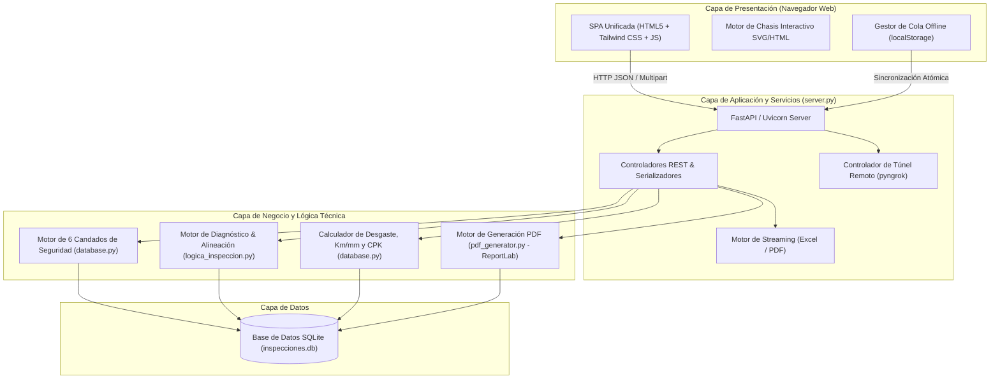
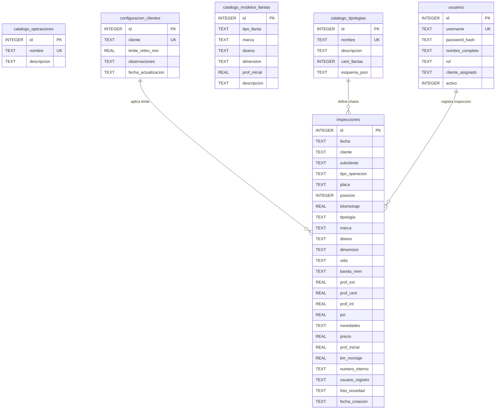
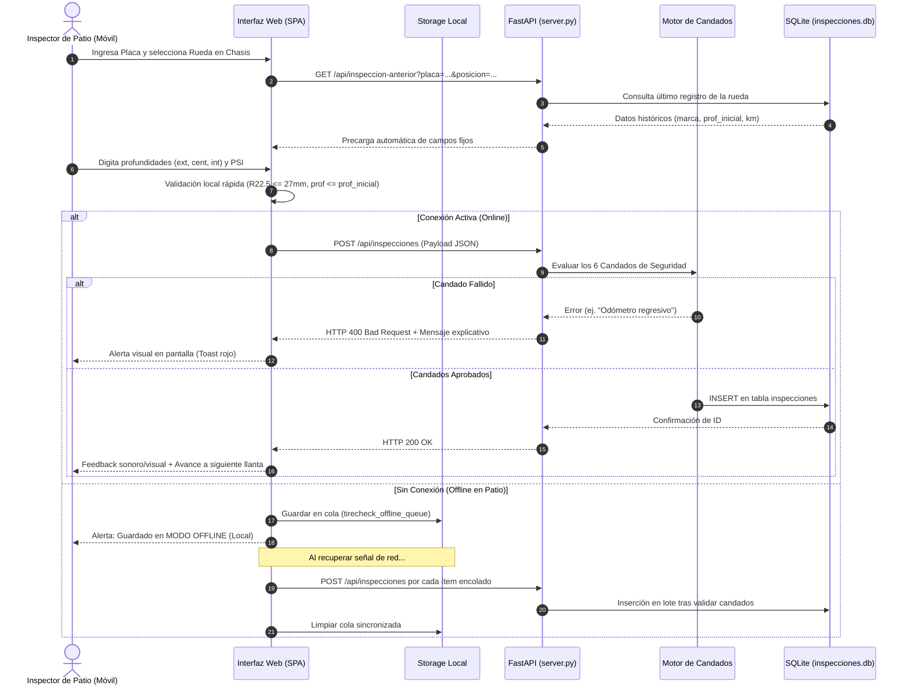

# Arquitectura del Sistema - TireAnalyze Pro

Este documento describe la arquitectura técnica, el modelo de datos, los componentes de software y el flujo de información de la plataforma **TireAnalyze Pro**.

---

## 1. Visión General de la Arquitectura

TireAnalyze Pro sigue el patrón de **Arquitectura en Capas (Layered Architecture)** con separación estricta de responsabilidades entre la interfaz de usuario en el navegador (Single Page Application), el gateway de servicios RESTful asíncronos en FastAPI, y el motor de persistencia y lógica de negocio en SQLite.

---

## 2. Modelo de Datos Relacional (SQLite)

La persistencia se gestiona en [inspecciones.db](file:///c:/Users/crist/OneDrive/Documentos/Tyre/TireAnalyze_Pro_Proyecto/inspecciones.db) con un esquema normalizado de 6 tablas:

### Descripción de Tablas

1. **`inspecciones`:** Tabla central de hechos. Almacena cada medición de rueda efectuada, incluyendo fecha, cliente, vehículo, posición física, odómetro, presiones, 3 surcos de profundidad y atributos económicos (precio de llanta y km de montaje).
2. **`catalogo_operaciones`:** Segmentación operativa del negocio (ej. Carga Seca, Refrigerado, Líquidos, Paquetería).
3. **`catalogo_tipologias`:** Define la arquitectura de los vehículos (ej. 4x2, 6x4, 8x4, Remolques) y contiene en `esquema_json` la distribución física de ejes, tipo de eje (direccional, tracción, remolque) y posiciones asociadas.
4. **`catalogo_modelos_llantas`:** Base de conocimiento de llantas del mercado con sus profundidades originales de fábrica para control de desgaste y autocompletado reactivo.
5. **`configuracion_clientes`:** Permite parametrizar umbrales personalizados de retiro de llantas por cliente (ej. 3.0 mm estándar vs. 4.0 mm para cargas pesadas).
6. **`usuarios`:** Control de acceso y roles (`admin` con permisos globales, `inspector` para captura en patio y `auditor` para consulta).

---

## 3. Ciclo de Vida de una Inspección

---

## 4. Estrategia Offline-First

Para permitir que los inspectores técnicos trabajen en sótanos, patios remotos o zonas industriales sin cobertura celular:
1. **Detección de Red:** El frontend escucha continuamente los eventos nativos de JavaScript `window.addEventListener('online')` y `offline`, actualizando un indicador visual de estado de conectividad en el encabezado.
2. **Cola de Encolamiento Local:** Si `navigator.onLine === false` o la petición HTTP falla por timeout de red, el payload JSON se encapsula con una marca de tiempo y se almacena en `localStorage` bajo la clave `tirecheck_offline_queue`.
3. **Sincronización Transaccional:** En cuanto se restablece la conexión, el frontend vacía la cola enviando secuencialmente cada inspección al endpoint `POST /api/inspecciones`. Si una inspección ya había sido registrada previamente, el servidor responde informando duplicidad sin detener la sincronización de las demás.

---

## 5. Motor de Chasis Interactivo

El mapeo visual del chasis en [templates/index.html](file:///c:/Users/crist/OneDrive/Documentos/Tyre/TireAnalyze_Pro_Proyecto/templates/index.html) es completamente dinámico y reactivo:
- **Consulta de Esquema:** Al seleccionar una tipología en el formulario, se invoca `GET /api/esquema?tipologia=...`, que consulta el campo `esquema_json` de la base de datos.
- **Renderizado por Ejes:** Se crea la estructura visual de la viga central del chasis (`chassis-spine`), barras de suspensión según el tipo de eje (direccional, tracción o trailer) y las ruedas en sus lados izquierdo y derecho.
- **Micro-estados Visuales:**
  - `selected`: Rueda actualmente activa para captura (borde azul celeste y efecto de realce).
  - `inspected`: Rueda ya completada en la jornada actual (fondo con indicador verde check).
  - `tire-steer-left` / `tire-steer-right`: Inclinación visual direccional en ruedas delanteras.

---

## 6. Generación de Reportes Técnicos en Streaming

TireAnalyze Pro genera documentos PDF binarios en memoria mediante **ReportLab** a través de [pdf_generator.py](file:///c:/Users/crist/OneDrive/Documentos/Tyre/TireAnalyze_Pro_Proyecto/pdf_generator.py):
- **Plan de Mantenimiento Vehicular (`/api/informe-pdf/{placa}`):**
  - Encabezado corporativo, odómetro, cliente y fecha.
  - Semáforo general de estado del vehículo (Alerta Roja: cambio urgente, Amarilla: alineación/dual, Verde: en norma).
  - Diagrama de ruedas por eje con profundidades individuales, desgastes y presiones.
  - Matriz de acciones correctivas inmediatas y espacio para firma de auditoría.
- **Consolidado de Flota (`/api/informe-pdf-consolidado`):**
  - Resumen macro de la jornada para gerencia de flota.
  - Distribución porcentual de problemas encontrados (porcentaje de llantas en descarte, porcentaje con falla de presión).
  - Listado condensado de todas las unidades inspeccionadas con sus novedades.
