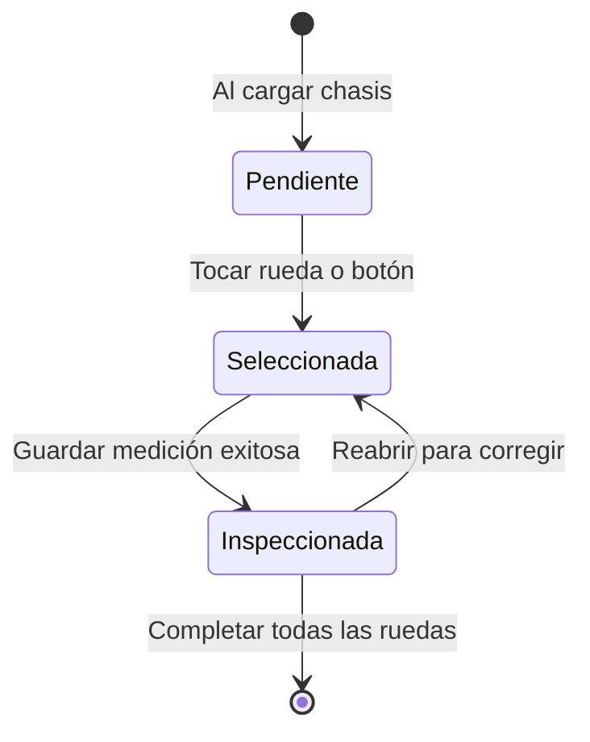

# Guía Técnica y Funcional: Chasis Interactivo por Ejes - TireCheck Pro

El **Chasis Interactivo por Ejes** es el componente central de captura visual y ergonómica de **TireCheck Pro**. Su propósito es transformar la inspección técnica de neumáticos en patio en un proceso intuitivo, libre de ambigüedades espaciales y optimizado para pantallas táctiles de dispositivos móviles y tablets.

---

## 1. Propósito y Ergonomía en Patio

En las auditorías tradicionales de flotas de carga pesada, los inspectores cometen errores frecuentes por confusión de nomenclatura:
- Confundir la llanta **dual interior** con la **dual exterior** en ejes tándem de tracción.
- Invertir el lado izquierdo con el derecho al cambiar de posición física alrededor del vehículo.
- Desconocer la numeración de los ejes en configuraciones complejas (ej. camiones *Cuatro Manos 8x4*, *Tráilers de 3 ejes* o *Biarticulados*).

### La Solución de TireCheck Pro:
El chasis interactivo renderiza una representación espacial isométrica en dos dimensiones del vehículo visto desde arriba (vista en planta o *top-down*), con orientación inequívoca (`FRENTE / CABINA`), permitiendo al técnico tocar directamente la rueda que tiene al frente en el patio.

---

## 2. Anatomía Visual y Arquitectura del Componente

```
                       ┌──────────────────────────────────────────────┐
                       │ ▲ FRENTE DE ENGANCHE (KINGPIN) / CABINA ▲    │  <-- Frente Dinámico Adaptativo
                       └──────────────────────────────────────────────┘
                       ◀ LADO IZQ (CONDUCTOR)     LADO DER (ACOMPAÑANTE) ▶  <-- Orientación Lateral

                                   [EJE 1 • DIRECCIONAL]               <-- Badge Técnico de Eje
                           ┌───┐            ││            ┌───┐
                           │ 1 │════════════╡╞════════════│ 2 │        <-- Viga Transversal + Bastidor
                           │DIR│            ││            │DIR│
                           └───┘            ││            └───┘
                                     LARGUEROS CONTINUOS
                                   [EJE 2 • TRACCIÓN DUAL]
                     ┌───┐ ┌───┐            ││            ┌───┐ ┌───┐
                     │ 3 │ │ 4 │════════════╡⚙╞════════════│ 5 │ │ 6 │  <-- Diferencial Central en Tracción
                     │EXT│ │INT│            ││            │INT│ │EXT│
                     └───┘ └───┘            ││            └───┘ └───┘
                                      DEL BASTIDOR
                     ════════════════════════════════════════════════
                     │      SOPORTE TÉCNICO DE LLANTA DE REPUESTO   │  <-- Cuna Inferior en Bastidor
                     │                      ┌───┐                   │
                     │                      │ 7 │                   │
                     │                      │REP│                   │
                     │                      └───┘                   │
                     └──────────────────────────────────────────────┘

                     ┌──────────────────────────────────────────────┐
                     │         Selector Rápido por Ejes:            │  <-- Selector Agrupado por Ejes
                     │ Eje 1: [1 DIR] [2 DIR]                       │
                     │ Eje 2: [3 EXT] [4 INT] [5 INT] [6 EXT]       │
                     └──────────────────────────────────────────────┘
                     [Marcar: Vehículo sin llanta de repuesto]         <-- Toggle de Repuesto
```

### Componentes Clave de la Nueva Arquitectura:
1. **Frente Dinámico Adaptativo (`#badgeFrenteChasis`):**
   - **Camiones y Tractocamiones:** Muestra `▲ FRENTE / CABINA DE CONDUCCIÓN ▲` con ícono de cabina (`fa-truck-front`) e iluminación en azul cian.
   - **Remolques y Tráilers:** Muestra `▲ FRENTE DE ENGANCHE (PERNO REY / KINGPIN) ▲` con ícono de enganche (`fa-link`) e iluminación en ámbar.
2. **Bastidor Continuo Longitudinal (`.chassis-stage` y `.chassis-rails-bg`):**
   - En lugar de vigas fragmentadas, implementa largueros gemelos continuos de acero longitudinal con travesaños estructurales (`.chassis-rail-tie`) que recorren la totalidad de los ejes rodantes.
3. **Distribución Anatómica Estricta de Duales:**
   - **Lado Izquierdo (Conductor):** La llanta exterior `EXT` queda en el extremo y la llanta interior `INT` junto al bastidor, con 6px de holgura técnica visible.
   - **Centro:** Viga transversal con barra codificada por tipo y diferencial mecánico (`fa-gear`) en ejes de tracción.
   - **Lado Derecho (Acompañante):** La llanta interior `INT` queda junto al bastidor y la exterior `EXT` en el extremo exterior.
4. **Módulo de Soporte de Repuesto en Bastidor:**
   - Ubicado en una cuna técnica dedicada al pie del chasis, desacoplado de los ejes rodantes.
   - Se activa únicamente para tipologías que poseen repuesto de serie (ej. *Trailer 2 Ejes + Repuesto*, *Trailer 3 Ejes + Repuesto*).
   - Sincronizado con el botón interactivo de desmarcado (`#btnSinRepuesto`), que atenúa la llanta a escala de grises con opacidad (`opacity-40 grayscale`).
5. **Selector Alternativo Agrupado por Ejes (`#gridBotonesPosicion`):**
   - Agrupa los botones por cada eje con títulos legibles, número de llanta, rol abreviado e indicador de check verde al completarse.
6. **Accesibilidad Integral:**
   - Navegación por teclado completa (soporte nativo para `Enter` y `Espacio`), `role="button"`, `tabindex="0"` y etiquetas `aria-label` descriptivas en cada neumático.

---

## 3. Máquina de Estados Visuales de las Ruedas

Cada rueda en el chasis transiciona reactivamente entre los siguientes estados:



| Estado | Clases CSS | Apariencia Visual | Significado |
|---|---|---|---|
| **Pendiente** | `.tire-graphic` | Fondo grafito oscuro, bordes grises (#475569), número blanco. | Neumático aún no medido en la jornada. |
| **Seleccionada (En Foco)** | `.tire-graphic.selected` | Borde azul cian luminoso (#38bdf8), halo de luz exterior (*glow*), escala agrandada al 108%, número cian. | Posición activa sobre la cual se registran las profundidades en el formulario. |
| **Inspeccionada (Completada)** | `.tire-graphic.inspected` | Fondo degradado verde esmeralda (#10b981), borde verde, **badge flotante con ícono de check** (`fa-check`) en la esquina superior derecha. | Medición guardada exitosamente y persistida en base de datos. |
| **Inclinación Direccional Izq.** | `.tire-steer-left` | Rotación física de **-10 grados**. | Simula el ángulo de giro de la rueda delantera izquierda. |
| **Inclinación Direccional Der.** | `.tire-steer-right` | Rotación física de **+10 grados**. | Simula el ángulo de giro de la rueda delantera derecha. |

---

## 4. Arquitectura y Modelo de Datos (`esquema_json`)

El chasis es 100% **data-driven**. En lugar de tener código HTML fijo para cada tipo de vehículo, la estructura se almacena en la tabla SQLite `catalogo_tipologias` en el campo `esquema_json`.

### Estructura Canónica del Esquema JSON:
```json
[
  {
    "eje": 1,
    "nombre": "EJE 1 DIRECCIONAL",
    "tipo": "direccional",
    "posiciones": [
      { "pos": 1, "lado": "izq", "rol": "DIR" },
      { "pos": 2, "lado": "der", "rol": "DIR" }
    ]
  },
  {
    "eje": 2,
    "nombre": "EJE 2 TRACCIÓN",
    "tipo": "traccion",
    "posiciones": [
      { "pos": 3, "lado": "izq", "rol": "EXT" },
      { "pos": 4, "lado": "izq", "rol": "INT" },
      { "pos": 5, "lado": "der", "rol": "INT" },
      { "pos": 6, "lado": "der", "rol": "EXT" }
    ]
  },
  {
    "eje": 3,
    "nombre": "REPUESTO",
    "tipo": "repuesto",
    "posiciones": [
      { "pos": 7, "lado": "izq", "rol": "REP" }
    ]
  }
]
```

### Atributos del Esquema:
- `eje` (entero): Número correlativo del eje.
- `nombre` (string): Título visible sobre el eje (ej. "EJE 1 TRAILER").
- `tipo` (string): Aplica el estilo y la barra correspondiente (`direccional`, `traccion`, `trailer`, `repuesto`).
- `posiciones` (array): Arreglo de ruedas pertenecientes al eje.
  - `pos`: Número físico oficial de la posición (1, 2, 3...).
  - `lado`: `'izq'` (lado del conductor) o `'der'` (lado del acompañante).
  - `rol`: Rol técnico (`DIR`, `INT`, `EXT`, `REP`).

---

## 5. Flujos de Automatización e Interacción

### 5.1 Precarga Histórica al Tocar una Rueda
Al pulsar cualquier rueda en el chasis:
1. El chasis dispara la función JavaScript `seleccionarPosicion(p)`.
2. Se actualiza el campo oculto `posicion` del formulario y la etiqueta visual `lblPosActualForm`.
3. Se invoca automáticamente al endpoint:
   ```http
   GET /api/inspeccion-anterior?placa=ABC123&posicion=10
   ```
4. Si la llanta ya fue inspeccionada en meses previos, el sistema **precarga automáticamente los atributos fijos**:
   - Marca (ej. *Michelin*)
   - Diseño (ej. *X Multi Z*)
   - Dimensión (ej. *295/80R22.5*)
   - Profundidad Inicial (ej. *16.5 mm*)
   - Número Interno (ej. *LL-1001*)
5. Aparece una insignia visual: `Historial Previa Encontrada`, evitando que el técnico tenga que reescribir datos ya conocidos.

---

### 5.2 Auto-Avance Inteligente tras Guardar
Al presionar el botón **"Guardar & Siguiente Llanta"**:
1. El backend evalúa los 6 candados de seguridad.
2. Si la transacción es exitosa, la rueda actual cambia inmediatamente al estado **Inspeccionada** (fondo verde con check).
3. La función `avanzarSiguientePosicion(posActual)` busca la siguiente rueda del vehículo que **aún no haya sido inspeccionada en la jornada**.
4. El foco y la iluminación cian se desplazan automáticamente a la siguiente rueda pendiente.
5. El técnico no necesita tocar la pantalla para seleccionar la siguiente llanta; simplemente toma la siguiente lectura con el profundímetro.

---

### 5.3 Detección de Vehículo Completo y Generación de PDF
Cuando el conjunto de ruedas pendientes llega a cero:
```javascript
const pendientes = listaPosicionesActual.filter(p => !posicionesInspeccionadasPlaca.has(p));
if (pendientes.length === 0) {
  mostrarToast(`🎉 ¡Vehículo ${placa} COMPLETADO!`);
  setTimeout(() => abrirModalInformePdf(placa), 600);
}
```
El sistema:
1. Muestra una notificación celebratoria en pantalla.
2. Abre automáticamente el modal del **Plan de Mantenimiento Vehicular en PDF**.
3. Permite descargar el informe técnico o compartirlo directamente por WhatsApp con el jefe de taller.

---

## 6. Sincronización en Modo Offline (Patios sin Cobertura)

Si el técnico se encuentra en un patio industrial sin cobertura 4G/5G ni Wi-Fi:
1. El chasis continúa operando con normalidad.
2. Cada inspección guardada se almacena en `localStorage` dentro de la cola `tirecheck_offline_queue`.
3. El chasis marca la rueda como completada (`.inspected`) localmente para no confundir al inspector.
4. El badge de estado de red superior muestra: `Offline (X pendientes)`.
5. Al volver a tener señal, el motor de sincronización sube automáticamente todas las llantas inspeccionadas al servidor central sin pérdida de datos.

---

## 7. Cómo Añadir una Nueva Tipología de Chasis

Para agregar una nueva configuración de camión (ejemplo: *Cabezote Cuatro Manos 8x4* o *Dolly de 2 Ejes*), **no es necesario modificar el código fuente**:

1. En la aplicación web, ve a la pestaña **Catálogos & Configuración** $\rightarrow$ **Tipologías de Vehículo**.
2. Haz clic en **"Nueva Tipología"**.
3. Ingresa el nombre, la cantidad de llantas y el esquema JSON de distribución de ejes.
4. Al guardar, la nueva tipología estará disponible de inmediato en el selector del patio y se renderizará automáticamente con todas las animaciones y candados de seguridad.
